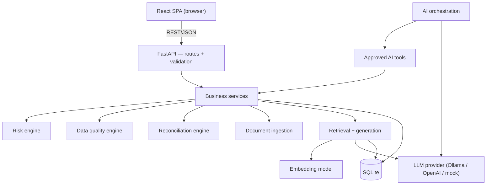

# Architecture

> **Status:** Living document. Sections are filled in as each phase lands.
> See [`implementation_status.md`](implementation_status.md) for progress.

## 1. Purpose

A locally runnable platform that combines **deterministic banking risk
calculations** with **AI-assisted regulatory document intelligence**. The
guiding rule: authoritative numbers come from tested deterministic code, never
from a language model.

## 2. Technology stack

| Concern | Choice | Rationale |
|---|---|---|
| Backend language | **Python 3.13** | Best ecosystem for data + AI; already present locally. |
| Web framework | **FastAPI** | Typed request/response models via Pydantic; automatic OpenAPI docs. |
| Database | **SQLite** (via SQLAlchemy 2.x + Alembic) | Zero-install, file-based, ideal for a local single-user app. Swappable to PostgreSQL by changing one URL. |
| Vector storage | **SQLite-backed embeddings + NumPy cosine search** | A few thousand chunks do not justify a separate service. |
| Embeddings | **sentence-transformers** `all-MiniLM-L6-v2` | Local, free, CPU-friendly, 384 dimensions. |
| LLM | **Ollama (local)** behind a provider interface, plus **OpenAI** and **mock** providers | Free/offline by default; cloud optional; deterministic mock keeps tests offline. |
| Orchestration | **Custom bounded tool loop** | Avoids heavyweight agent frameworks; easy to bound, log and evaluate. |
| Frontend | **React 19 + TypeScript + Vite 8 + Tailwind CSS 4 + Recharts** | Standard, fast to develop, well suited to data tables and charts. |
| Tests | **pytest** (backend), planned **Vitest** (frontend) | Offline, reproducible. |
| Config | **Environment variables** (`.env`, never committed) | 12-factor style; secrets stay out of source. |

## 3. High-level component view



## 4. Layering rules

Concerns are kept separate so any one can change without a rewrite:

- **Presentation** (frontend) knows only the REST API.
- **API** validates input and shapes output; contains no business logic.
- **Services** hold business logic and are the only callers of repositories.
- **Engines** (risk, data quality, reconciliation) are pure, deterministic and
  individually unit-testable.
- **Ingestion / RAG** sit behind interfaces for parser, embedder and generator.
- **AI tools** wrap services with typed schemas, limits and audit logging.
- **Orchestration** decides *which* tool to call; it never performs arithmetic.
- **Persistence** is accessed only through the data-access layer.

## 5. Data flow (target end-state)

1. A synthetic-data generator seeds SQLite with counterparties, exposures,
   ratings, collateral, rules and two source snapshots.
2. Engines run on demand: RWA calculation, data-quality checks, reconciliation.
3. Regulatory PDFs are ingested, chunked, embedded and indexed.
4. A user question is routed by the orchestrator: it may call document search,
   structured-data tools, or both.
5. The LLM drafts an answer strictly from tool results; citations are verified
   against the actual retrieved records before display.
6. Every run, calculation and tool call is written to audit tables.

## 6. Repository layout

```
backend/
  app/
    core/        config, logging, security helpers
    db/          engine, session, ORM models, migrations
    schemas/     Pydantic request/response models
    api/routes/  HTTP endpoints
    services/    risk, data-quality, reconciliation, ingestion, rag, orchestration
    tools/       approved AI tools
    providers/   llm + embeddings adapters
    seed/        synthetic data generator
  tests/
frontend/
  src/
    api/         typed API client
    components/  layout, tables, charts, citations
    pages/       the seven application pages
docs/
```

## 7. Security posture (summary)

- Read-only analytical database access for AI operations.
- No arbitrary SQL from the AI layer; only typed, allow-listed tools.
- Retrieved documents are treated as **untrusted evidence**, never instructions
  (prompt-injection defense).
- Secrets only via environment variables; `.env` is git-ignored.
- All data is synthetic; no employer/client/customer data.

See [`threat_model.md`](threat_model.md) for details (completed in Phase 8/10).
